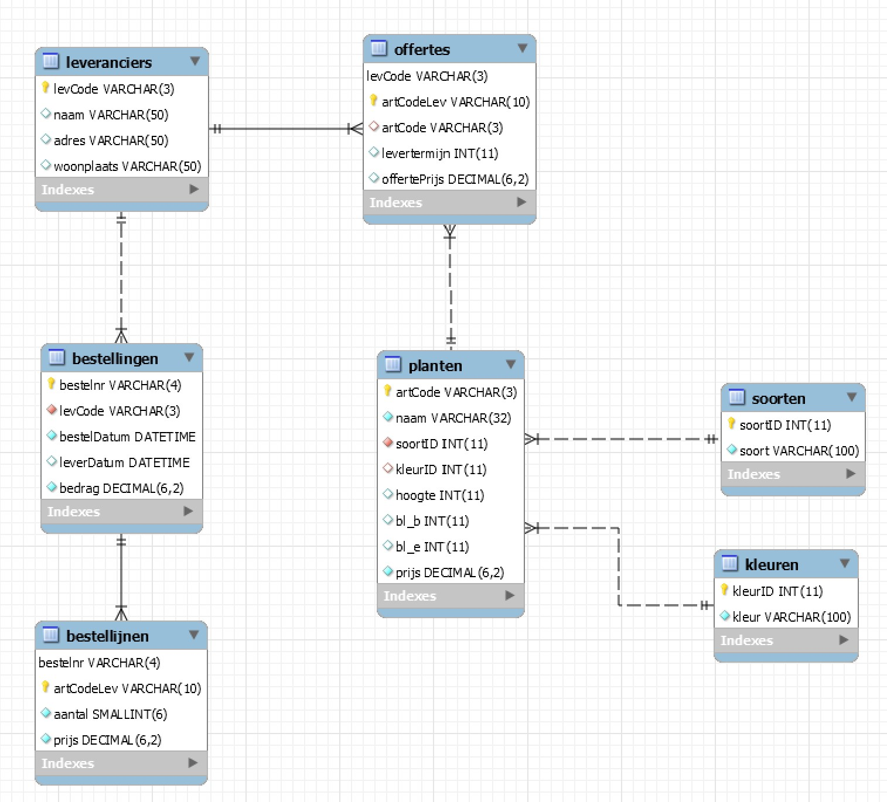

# 06 - Workshop SQL : Planten

## Diagram

    

> Meer informatie over de databank kan je [hier](structure.md) vinden.

## Oefening 4 - Subqueries

1. Welke planten zijn hoger dan de gemiddelde hoogte over alle planten heen?  
Sorteer op artCode
    > artCode	naam	soortID	kleurID	hoogte	bl_b	bl_e	prijs  
    > 012	Sering	5	8	500	5	6	19.50  
    > 027	Paardekastanje	4	12	2500	5	5	17.50  
    > 028	Linde	4	3	4000	7	8	42.50  
    > 031	Wijnstok	7		600			10.00  
    > 039	Populier	4	12	1000	3	4	4.50  
    > 047	Zilverspar	4		3000			19.50  
    > 066	Dwergcypres	4		500			13.50  
    > ... (21 records)

2. Welke planten hebben dezelfde kleur als de Sering?  
De Sering staat niet in de oplossing. Sorteer op artCode
    > artCode	naam	soortID	kleurID	hoogte	bl_b	bl_e	prijs  
    > 180	Bosrank	7	8	300	7	9	6.50  
    > 297	Majoraan	8	8	30	7	8	2.00  
    > 311	Leverkruid	9	8	175	8	9	2.50  
    > 351	Tijm	8	8	10	6	6	2.50  
    > 425	Bieslook	8	8	20	7	8	2.00  
    > 426	Alyssum	1	8	10	6	9	0.60  
    > 437	Munt	8	8	40	8	8	2.00

3. Geef de unieke maanden (verschillend van NULL) waarin de bloei begint van planten die door leverancier BAUMGARTEN R. aangeboden worden.  
Sorteer oplopend
    > 1 tot en met 9 (uitgezonderd 3 en 8)

4. Onze aankoper moet op bezoek bij leverancier HOVENIER G.H.  
Hij zal van de gelegenheid gebruik maken om ook de andere leveranciers uit dezelfde woonplaats te bezoeken.  
Geef de lijst van deze leveranciers. Opgelet: HOVENIER G.H. komt niet voor in de lijst!
    > levCode	naam	adres	woonplaats  
    > 011	STRUIK BV.	BESSENLAAN 1	LISSE  
    > 014	DEZAAIER L.J.A.	DE GRONDEN 101	LISSE  
    > 021	TRA A.	KOELEPLEKSTRAAT 10	LISSE

5. Geef de duurste planten
    > artCode	naam	soortID	kleurID	hoogte	bl_b	bl_e	prijs  
    > 028	Linde	4	3	4000	7	8	42.50

    Breid de vorige query uit.  
    Welke planten behoren tot dezelfde soort als de duurste plant?  
    Sorteer op artCode
    > artCode	naam	soortID	kleurID	hoogte	bl_b	bl_e	prijs  
    > 027	Paardekastanje	4	12	2500	5	5	17.50  
    > 028	Linde	4	3	4000	7	8	42.50  
    > 039	Populier	4	12	1000	3	4	4.50  
    > 047	Zilverspar	4		3000			19.50  
    > 066	Dwergcypres	4		500			13.50  
    > 104	Esdoorn	4	5	2500	6	6	17.50  
    > 162	Azijnboom	4	9		6	7	9.50  
    > ... (17 records)

6. Geef alle leveranciers die een offerte gemaakt hebben voor heideplanten (soort `heide`)
    > levCode	naam	adres	woonplaats  
    > 011	STRUIK BV.	BESSENLAAN 1	LISSE  
    > 013	SPITMAN EN ZN.	ACHTERTUIN 9	AALSMEER  
    > 022	ERICA BV.	BERKENWEG 87	HEEMSTEDE

7. Geef de leveranciers waarbij in minstens 2 verschillende maanden iets besteld werd.
    > levCode	naam	adres	woonplaats  
    > 004	HOVENIER G.H.	ZANDWEG 50	LISSE  
    > 013	SPITMAN EN ZN.	ACHTERTUIN 9	AALSMEER

    Breid de vorige query uit  
    Zijn er leveranciers waarbij in elke maand van 2003, zoals aanwezig in de databank, iets besteld werd?
    > Antwoord: Resultset is leeg

8. Het bedrag van een bestelling bevat eventueel een korting.  
Bij welke bestellingen is het bedrag groter dan of gelijk aan de som van (aantal × prijs) van de bestellijnen?  
Met andere woorden: bij welke bestellingen werd géén korting verrekend? Sorteer oplopend op bestelnr
    > bestelnr	levCode	bestelDatum	leverDatum	bedrag  
    > 0174	004	2003-02-25 00:00:00	2003-03-04 00:00:00	117.50  
    > 0184	022	2003-06-06 00:00:00	2003-03-16 00:00:00	240.00  
    > 0200	004	2003-03-14 00:00:00	2003-03-21 00:00:00	72.00  
    > 0201	004	2003-03-26 00:00:00	2003-04-02 00:00:00	221.25

9. Welke bestellingen bevatten artikelen die duurder besteld werden dan de huidige offerteprijs van diezelfde leverancier voor dat artikel?  
Geef bestelnr, levCode en bestelDatum. Sorteer op bestelnr
    > bestelnr	levCode	bestelDatum  
    > 0174	004	2003-02-25 00:00:00  
    > 0181	009	2003-03-06 00:00:00  
    > 0184	022	2003-06-06 00:00:00  
    > 0186	020	2003-01-11 00:00:00  
    > 0192	035	2003-03-13 00:00:00  
    > 0197	035	2003-03-14 00:00:00  
    > 0200	004	2003-03-14 00:00:00  
    > 0201	004	2003-03-26 00:00:00  
    > 0202	014	2003-03-26 00:00:00

10. Geef alle planten met de langste bloeiperiode.  
Geef artCode, naam, soort, kleur en bloeiperiode (het aantal maanden dat de plant bloeit, begin- en eindmaand inbegrepen)
    > artCode	naam	soort	kleur	bloeiperiode  
    > 157	Viooltje	2-jarig	gemengd	6

### Oplossing
Een mogelijke oplossing voor deze oefening vind je [hier](/workshops/07-SQL/solutions/planten/exercise-4.md)
