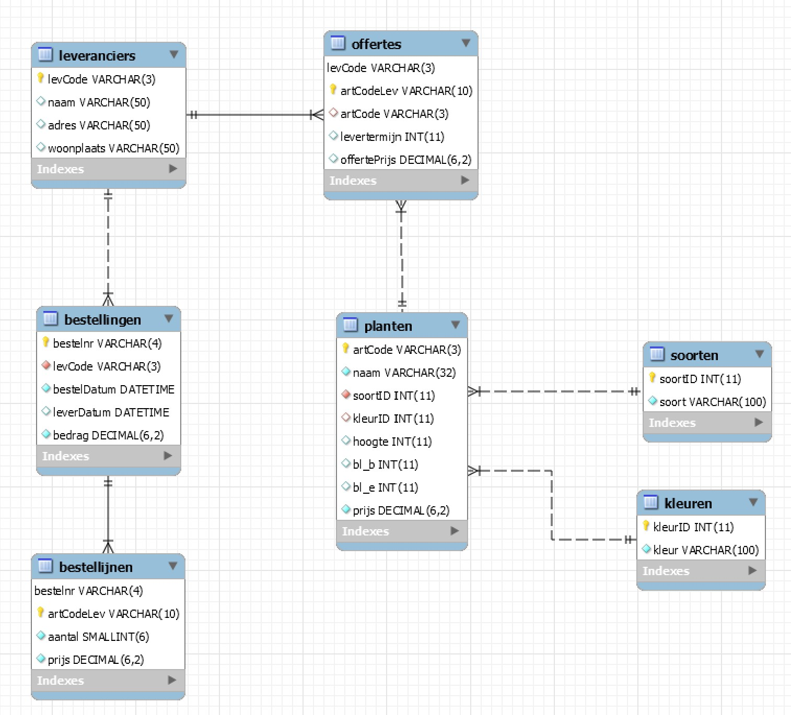

# 06 - Workshop SQL : Planten

## Diagram
<p align="center">
    
</p>

> Meer informatie over de databank kan je [hier](../../exercises/planten/structure.md) vinden.

## Oplossingen 4 - Subqueries

1. Welke planten zijn hoger dan de gemiddelde hoogte over alle planten heen?  
Sorteer op artCode
    > artCode	naam	soortID	kleurID	hoogte	bl_b	bl_e	prijs  
    > 012	Sering	5	8	500	5	6	19.50  
    > 027	Paardekastanje	4	12	2500	5	5	17.50  
    > 028	Linde	4	3	4000	7	8	42.50  
    > 031	Wijnstok	7		600			10.00  
    > 039	Populier	4	12	1000	3	4	4.50  
    > 047	Zilverspar	4		3000			19.50  
    > 066	Dwergcypres	4		500			13.50  
    > ... (21 records)
    ```sql
    SELECT *
    FROM planten
    WHERE hoogte > (
        SELECT AVG(hoogte)
        FROM planten
    )
    ORDER BY artCode;
    ```

    > **Let op:** `AVG` negeert `NULL`-waarden. Het gemiddelde (364,77 cm) wordt berekend over de 110 planten
    > waarvan de hoogte gekend is, niet over alle 119 planten (zie ook oefening 2.7). Planten zonder hoogte komen
    > nooit in het resultaat: `NULL > 364.77` is niet waar, maar *onbekend*.

2. Welke planten hebben dezelfde kleur als de Sering?  
De Sering staat niet in de oplossing. Sorteer op artCode
    > artCode	naam	soortID	kleurID	hoogte	bl_b	bl_e	prijs  
    > 180	Bosrank	7	8	300	7	9	6.50  
    > 297	Majoraan	8	8	30	7	8	2.00  
    > 311	Leverkruid	9	8	175	8	9	2.50  
    > 351	Tijm	8	8	10	6	6	2.50  
    > 425	Bieslook	8	8	20	7	8	2.00  
    > 426	Alyssum	1	8	10	6	9	0.60  
    > 437	Munt	8	8	40	8	8	2.00
    ```sql
    SELECT *
    FROM planten
    WHERE kleurID = (
        SELECT kleurID
        FROM planten
        WHERE naam = 'Sering'
    ) AND naam <> 'Sering'
    ORDER BY artCode;
    ```

    > **Let op:** de kolom `naam` is **niet uniek** in de tabel planten. Probeer dezelfde query eens met `'Klaproos'`
    > (3 planten met 2 verschillende kleuren): je krijgt `Error 1242: Subquery returns more than 1 row`.
    > Een `=` verwacht precies één waarde; gebruik `IN` als de subquery meerdere rijen kan teruggeven.

3. Geef de unieke maanden (verschillend van NULL) waarin de bloei begint van planten die door leverancier BAUMGARTEN R. aangeboden worden.  
Sorteer oplopend
    > 1 tot en met 9 (uitgezonderd 3 en 8)
    ```sql
    SELECT DISTINCT bl_b
    FROM planten
    WHERE artCode IN (
        SELECT artCode
        FROM offertes
        WHERE levCode = (
            SELECT levCode
            FROM leveranciers
            WHERE naam = 'BAUMGARTEN R.'
        )
    ) AND bl_b IS NOT NULL
    ORDER BY bl_b;
    ```

    Equivalente oplossing zonder subquery:

    ```sql
    SELECT DISTINCT p.bl_b
    FROM planten p
        JOIN offertes o ON o.artCode = p.artCode
        JOIN leveranciers l ON l.levCode = o.levCode
    WHERE l.naam = 'BAUMGARTEN R.' AND p.bl_b IS NOT NULL
    ORDER BY p.bl_b;
    ```

    > **Let op:** zonder `DISTINCT` krijg je 18 rijen in plaats van 7. Bij de oplossing met subquery blijft
    > `DISTINCT` ook nodig: verschillende planten kunnen in dezelfde maand beginnen te bloeien.

4. Onze aankoper moet op bezoek bij leverancier HOVENIER G.H.  
Hij zal van de gelegenheid gebruik maken om ook de andere leveranciers uit dezelfde woonplaats te bezoeken.  
Geef de lijst van deze leveranciers. Opgelet: HOVENIER G.H. komt niet voor in de lijst!
    > levCode	naam	adres	woonplaats  
    > 011	STRUIK BV.	BESSENLAAN 1	LISSE  
    > 014	DEZAAIER L.J.A.	DE GRONDEN 101	LISSE  
    > 021	TRA A.	KOELEPLEKSTRAAT 10	LISSE
    ```sql
    SELECT levCode, naam, adres, woonplaats
    FROM leveranciers
    WHERE woonplaats = (
        SELECT woonplaats
        FROM leveranciers
        WHERE naam = 'HOVENIER G.H.'
    )
    AND naam <> 'HOVENIER G.H.';
    ```

    > **Tip:** de namen staan in hoofdletters in de databank. Met de standaard collation van MySQL
    > (`utf8_general_ci`, *case insensitive*) werkt `'Hovenier G.H.'` ook.

5. Geef de duurste planten
    > artCode	naam	soortID	kleurID	hoogte	bl_b	bl_e	prijs  
    > 028	Linde	4	3	4000	7	8	42.50
    ```sql
    SELECT *
    FROM planten
    WHERE prijs = (
        SELECT MAX(prijs)
        FROM planten
    );
    ```

    Breid de vorige query uit.  
    Welke planten behoren tot dezelfde soort als de duurste plant?  
    Sorteer op artCode
    > artCode	naam	soortID	kleurID	hoogte	bl_b	bl_e	prijs  
    > 027	Paardekastanje	4	12	2500	5	5	17.50  
    > 028	Linde	4	3	4000	7	8	42.50  
    > 039	Populier	4	12	1000	3	4	4.50  
    > 047	Zilverspar	4		3000			19.50  
    > 066	Dwergcypres	4		500			13.50  
    > 104	Esdoorn	4	5	2500	6	6	17.50  
    > 162	Azijnboom	4	9		6	7	9.50  
    > ... (17 records)
    ```sql
    SELECT *
    FROM planten
    WHERE soortID IN (              -- IN i.p.v. = : robuust als er meerdere duurste planten zijn
        SELECT soortID
        FROM planten
        WHERE prijs = (
            SELECT MAX(prijs)
            FROM planten
        )
    )
    ORDER BY artCode;
    ```

    > **Let op:** dit is een subquery *in* een subquery. Gebruik bij voorkeur `IN` in plaats van `=` voor de buitenste
    > subquery: nu is er maar één duurste plant (de Linde), maar als twee planten van een andere soort ooit dezelfde
    > hoogste prijs krijgen, faalt `=` met *Subquery returns more than 1 row*.

6. Geef alle leveranciers die een offerte gemaakt hebben voor heideplanten (soort `heide`)
    > levCode	naam	adres	woonplaats  
    > 011	STRUIK BV.	BESSENLAAN 1	LISSE  
    > 013	SPITMAN EN ZN.	ACHTERTUIN 9	AALSMEER  
    > 022	ERICA BV.	BERKENWEG 87	HEEMSTEDE
    ```sql
    SELECT *
    FROM leveranciers
    WHERE levCode IN (
        SELECT levCode
        FROM offertes
        WHERE artCode IN (
            SELECT artCode
            FROM planten
            WHERE soortID = (
                SELECT soortID
                FROM soorten
                WHERE soort = 'heide'
            )
        )
    );
    ```

    Equivalente oplossing zonder subquery:

    ```sql
    SELECT DISTINCT l.*
    FROM leveranciers l
        JOIN offertes o ON o.levCode = l.levCode
        JOIN planten p ON p.artCode = o.artCode
        JOIN soorten s ON s.soortID = p.soortID
    WHERE s.soort = 'heide';
    ```

    > **Let op:** zonder `DISTINCT` geeft de JOIN-versie 7 rijen in plaats van 3 (STRUIK BV. biedt 4 heideplanten aan).
    > De versie met `IN` heeft dat probleem niet: elke leverancier wordt maar één keer getest.

7. Geef de leveranciers waarbij in minstens 2 verschillende maanden iets besteld werd.
    > levCode	naam	adres	woonplaats  
    > 004	HOVENIER G.H.	ZANDWEG 50	LISSE  
    > 013	SPITMAN EN ZN.	ACHTERTUIN 9	AALSMEER
    ```sql
    SELECT *
    FROM leveranciers l
    WHERE (
        SELECT COUNT(DISTINCT MONTH(bestelDatum))
        FROM bestellingen b
        WHERE b.levCode = l.levCode
    ) >= 2;
    ```

    > **Let op:** `COUNT(*)` telt bestellingen, geen maanden. Met `COUNT(*) >= 2` krijg je 4 leveranciers,
    > want DEZAAIER L.J.A. en FLORA BV. bestelden 2 keer, maar telkens in maart.

    Breid de vorige query uit  
    Zijn er leveranciers waarbij in elke maand van 2003, zoals aanwezig in de databank, iets besteld werd?
    > Antwoord: Resultset is leeg
    ```sql
    SELECT *
    FROM leveranciers l
    WHERE
    (
        SELECT COUNT(DISTINCT MONTH(bestelDatum))
        FROM bestellingen b
        WHERE b.levCode = l.levCode AND YEAR(bestelDatum) = 2003
    )
    =
    (
        SELECT COUNT(DISTINCT MONTH(bestelDatum))
        FROM bestellingen
        WHERE YEAR(bestelDatum) = 2003
    );
    ```

    > In 2003 komen 5 maanden voor in de databank (januari, februari, maart, april en juni).
    > Geen enkele leverancier haalt meer dan 2 verschillende maanden.

8. Het bedrag van een bestelling bevat eventueel een korting.  
Bij welke bestellingen is het bedrag groter dan of gelijk aan de som van (aantal × prijs) van de bestellijnen?  
Met andere woorden: bij welke bestellingen werd géén korting verrekend? Sorteer oplopend op bestelnr
    > bestelnr	levCode	bestelDatum	leverDatum	bedrag  
    > 0174	004	2003-02-25 00:00:00	2003-03-04 00:00:00	117.50  
    > 0184	022	2003-06-06 00:00:00	2003-03-16 00:00:00	240.00  
    > 0200	004	2003-03-14 00:00:00	2003-03-21 00:00:00	72.00  
    > 0201	004	2003-03-26 00:00:00	2003-04-02 00:00:00	221.25
    ```sql
    SELECT *
    FROM bestellingen b
    WHERE b.bedrag >= (
        SELECT SUM(bl.aantal * bl.prijs)
        FROM bestellijnen bl
        WHERE bl.bestelnr = b.bestelnr
    )
    ORDER BY b.bestelnr;
    ```

    Equivalente oplossing met `GROUP BY` / `HAVING`:

    ```sql
    SELECT b.*
    FROM bestellingen b
        JOIN bestellijnen bl ON bl.bestelnr = b.bestelnr
    GROUP BY b.bestelnr, b.levCode, b.bestelDatum, b.leverDatum, b.bedrag
    HAVING b.bedrag >= SUM(bl.aantal * bl.prijs)
    ORDER BY b.bestelnr;
    ```

    > **Let op:** het is `SUM(aantal * prijs)` en niet `SUM(prijs)`. Met `SUM(prijs)` komen alle 15 bestellingen in het
    > resultaat, omdat de som van de eenheidsprijzen altijd veel kleiner is dan het bedrag.

9. Welke bestellingen bevatten artikelen die duurder besteld werden dan de huidige offerteprijs van diezelfde leverancier voor dat artikel?  
Geef bestelnr, levCode en bestelDatum. Sorteer op bestelnr
    > bestelnr	levCode	bestelDatum  
    > 0174	004	2003-02-25 00:00:00  
    > 0181	009	2003-03-06 00:00:00  
    > 0184	022	2003-06-06 00:00:00  
    > 0186	020	2003-01-11 00:00:00  
    > 0192	035	2003-03-13 00:00:00  
    > 0197	035	2003-03-14 00:00:00  
    > 0200	004	2003-03-14 00:00:00  
    > 0201	004	2003-03-26 00:00:00  
    > 0202	014	2003-03-26 00:00:00
    ```sql
    SELECT DISTINCT b.bestelnr, b.levCode, b.bestelDatum
    FROM bestellingen b
        JOIN bestellijnen bl ON bl.bestelnr = b.bestelnr
    WHERE bl.prijs > (
        SELECT o.offertePrijs
        FROM offertes o
        WHERE o.levCode = b.levCode         -- de leverancier van de bestelling ...
          AND o.artCodeLev = bl.artCodeLev  -- ... én zijn artikelcode
    )
    ORDER BY b.bestelnr;
    ```

    Equivalente oplossing zonder subquery:

    ```sql
    SELECT DISTINCT b.bestelnr, b.levCode, b.bestelDatum
    FROM bestellingen b
        JOIN bestellijnen bl ON bl.bestelnr = b.bestelnr
        JOIN offertes o ON o.levCode = b.levCode
                       AND o.artCodeLev = bl.artCodeLev
    WHERE bl.prijs > o.offertePrijs
    ORDER BY b.bestelnr;
    ```

    > **Denk goed na:** een artikel bij een leverancier wordt geïdentificeerd door de **combinatie** `levCode` + `artCodeLev`
    > (samengestelde primaire sleutel van offertes). Dezelfde `artCodeLev` kan bij verschillende leveranciers
    > een ander artikel zijn: `A103` is bij HOVENIER G.H. een Viooltje en bij SPITMAN EN ZN. een Iris.
    >
    > - Laat je `o.levCode = b.levCode` weg in de subquery, dan krijg je `Error 1242: Subquery returns more than 1 row`.
    > - Laat je die voorwaarde weg in een `IN`- of `JOIN`-versie, dan krijg je **geen fout maar 11 bestellingen**:
    >   0175 en 0203 komen er onterecht bij. 0175 bevat `A103` aan 0.20, wat vergeleken wordt met de offerte van een
    >   andere leverancier (013, 0.10). 0203 bevat `CYNO` aan 1.40, wat vergeleken wordt met de offerte van leverancier 034 (0.60).
    >
    > Bestellijn `474` van bestelling 0186 heeft geen offerte. De subquery levert dan `NULL` op en die lijn valt weg.
    > Bestelling 0186 staat toch in het resultaat dankzij haar andere lijnen.

10. Geef alle planten met de langste bloeiperiode.  
Geef artCode, naam, soort, kleur en bloeiperiode (het aantal maanden dat de plant bloeit, begin- en eindmaand inbegrepen)
    > artCode	naam	soort	kleur	bloeiperiode  
    > 157	Viooltje	2-jarig	gemengd	6
    ```sql
    SELECT p.artCode, p.naam, s.soort, k.kleur, p.bl_e - p.bl_b + 1 AS bloeiperiode
    FROM planten p
        JOIN soorten s ON s.soortID = p.soortID
        LEFT JOIN kleuren k ON k.kleurID = p.kleurID
    WHERE p.bl_e - p.bl_b = (
        SELECT MAX(bl_e - bl_b)
        FROM planten
    );
    ```

    > **Let op:** van maart tot en met augustus is 6 maanden, niet `8 - 3 = 5`, vandaar de `+ 1`.
    > Gebruik in de subquery dezelfde berekening als in de `WHERE` (of tel er in beide `+ 1` bij).
    > De 15 planten waarvan `bl_b` of `bl_e` NULL is, worden door `MAX` genegeerd.
    > De `LEFT JOIN` met kleuren zorgt ervoor dat een plant zonder kleur (kleurID is NULLABLE) niet verdwijnt.

## Oefeningen
Klik [hier](../../exercises.md) om terug te gaan naar de oefeningen.
